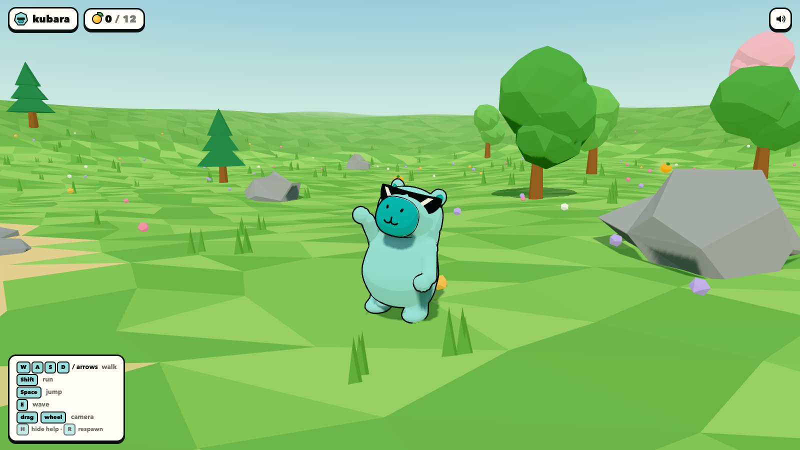
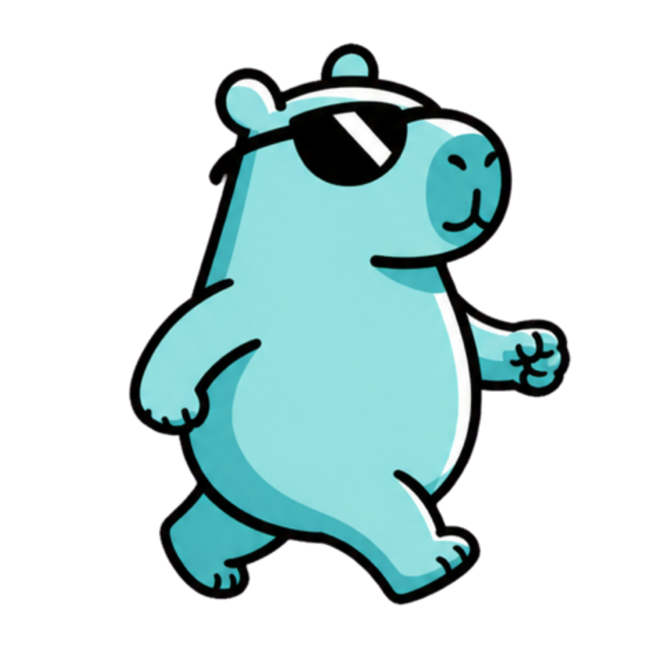
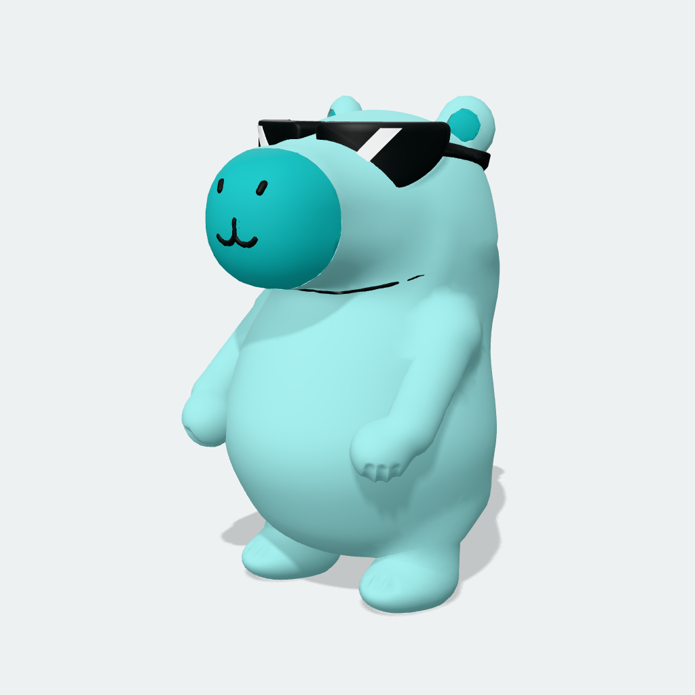
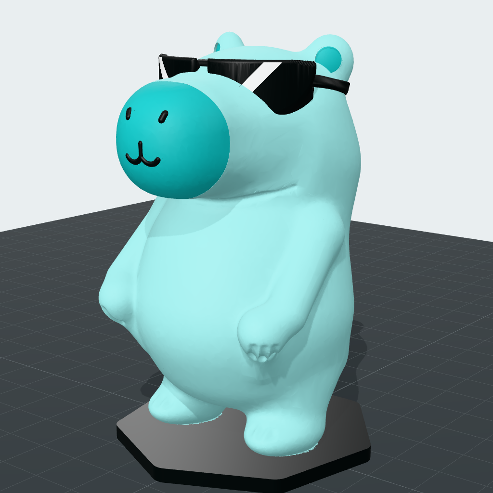
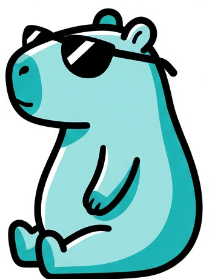
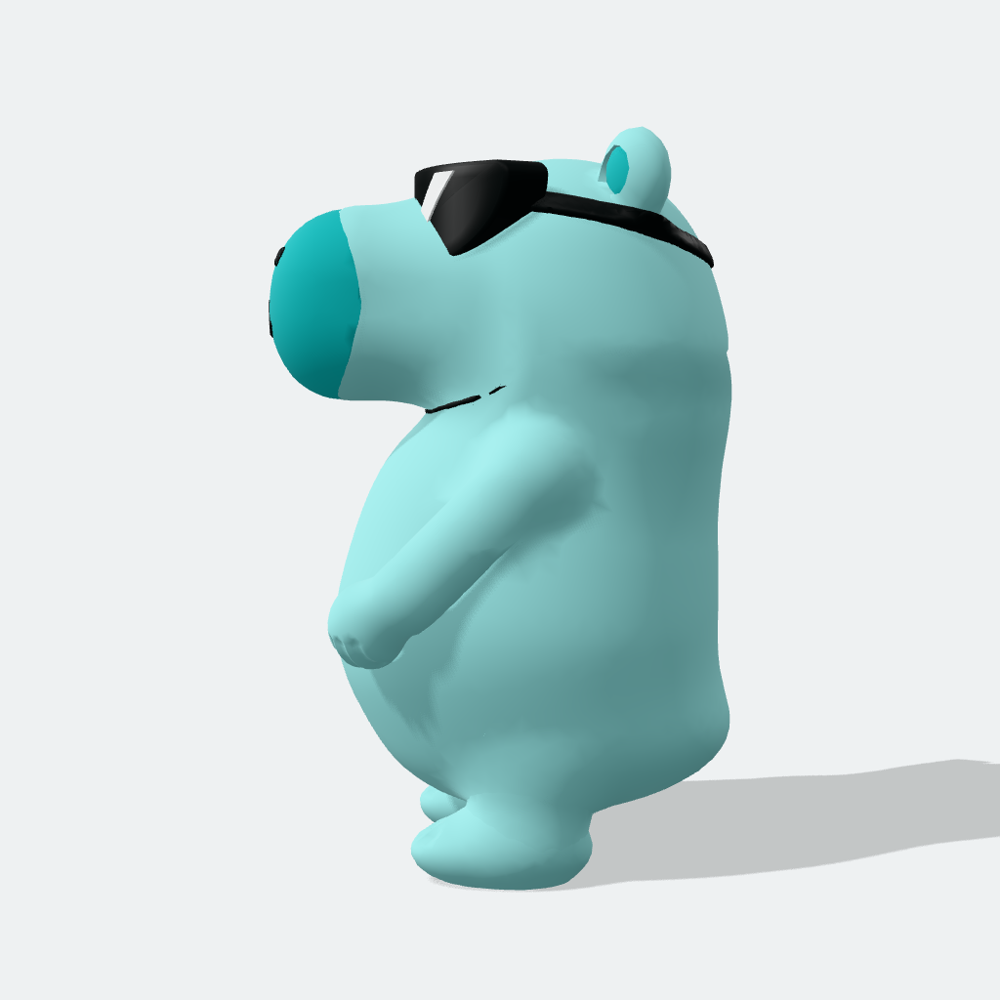
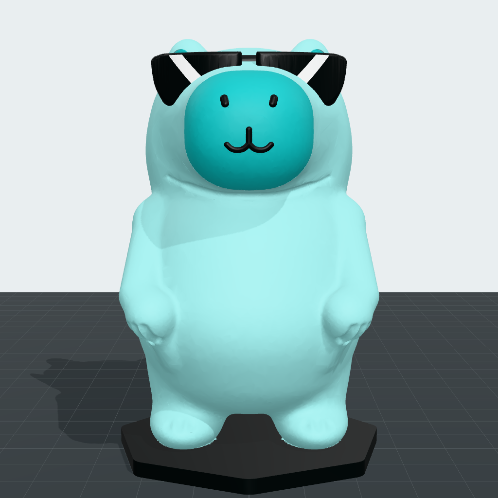
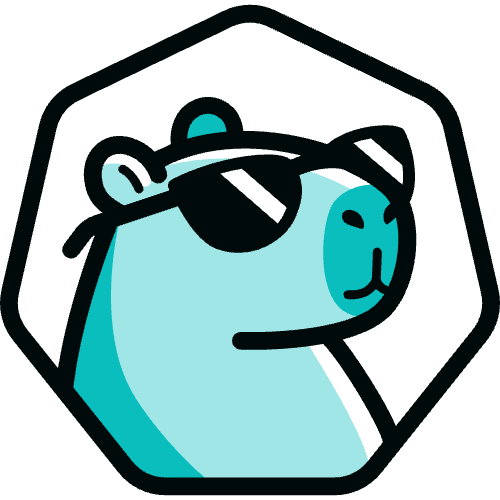
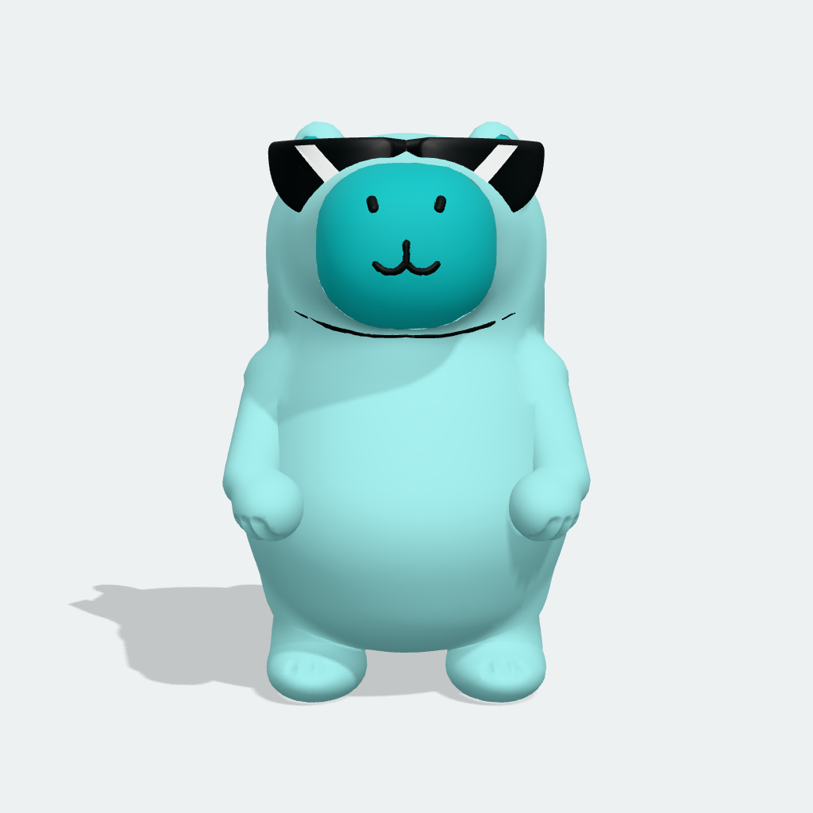
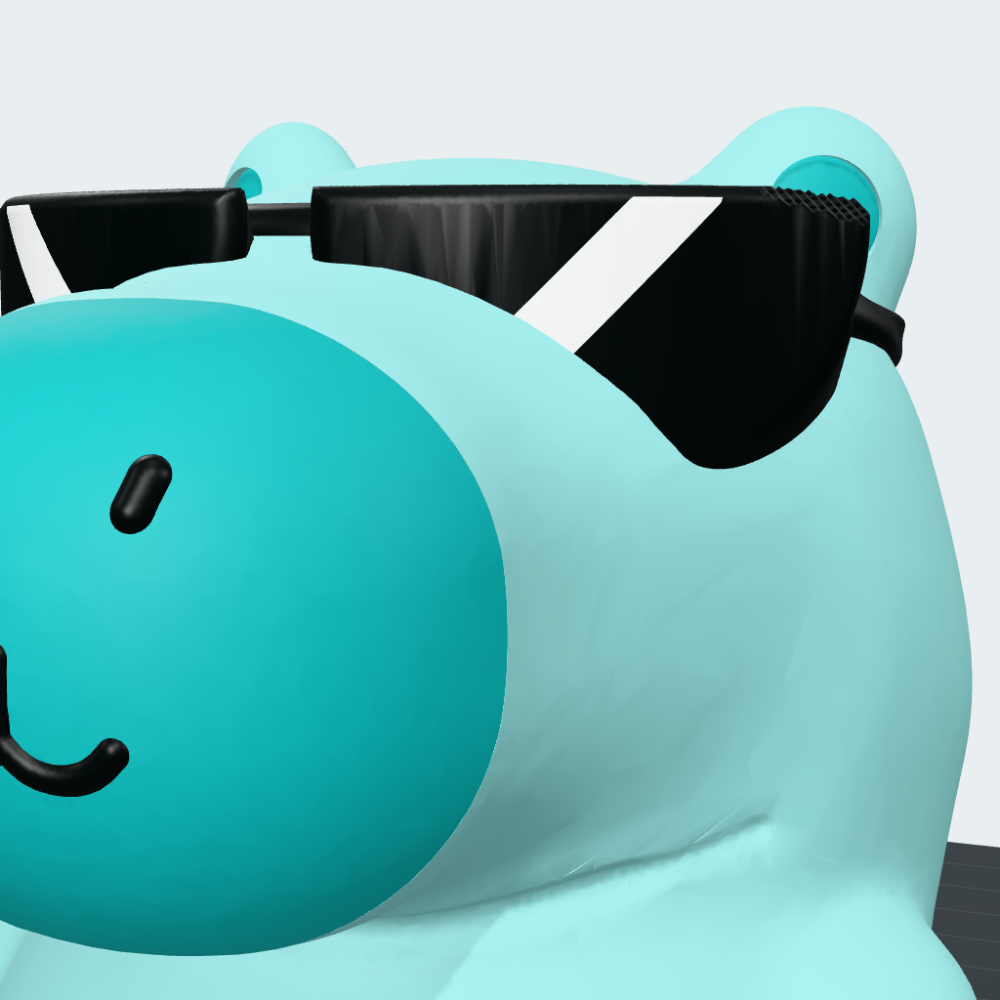

# kubara 3D mascot

**▶ Play the demo: https://huhn511.github.io/kubara-mascot/**



A 3D version of **kubara**, the chill capybara in sunglasses from [kubara.io](https://kubara.io/community/). One parametric model produces both:

- **`dist/kubara.glb`**: a game-ready three.js asset. It is 1.0 m tall, Y-up, faces +Z and has about 29.7k triangles. Its 24 named parts have pivots at the joints, so it can be animated without skinning.
- **`dist/print/`**: 3D-print files. There is a watertight single-colour STL at 80 mm on a kubara heptagon base, a 120 mm version, a 4-colour 3MF for Bambu Studio and OrcaSlicer, and the separate colour parts.

It also includes a small three.js game (`game/`) where you walk kubara around a meadow with a steaming onsen pond and collect yuzu fruit.


## Gallery

| Reference (kubara.io) | 3D model (game GLB) | 3D print (multi-colour preview) |
|---|---|---|
|  |  |  |
|  |  |  |
|  |  |  |

More renders:

- **Model:** [front](renders/front.png), [3/4](renders/three_quarter.png), [side](renders/side.png), [back](renders/back.png), [top](renders/top.png).
- **Poses:** [wave](renders/pose_wave140.png), [walk](renders/pose_walk35.png), [head turn](renders/pose_head_yaw25.png).
- **Game:** [idle](renders/game_idle.png), [walk](renders/game_walk.png), [run](renders/game_run.png), [jump](renders/game_jump.png), [wave](renders/game_wave.png), [pond](renders/game_pond.png), [phone](renders/game_mobile.png).
- **Print:** [single-colour STL](renders/print_three_quarter.png), [back](renders/print_mc_back.png), [support heat map](renders/print_overhang_chin.png), [scale comparison](renders/print_scale.png).
- **Reference art:** [pose sheet](reference/kubara-catch-poses.png), [cheer](reference/views/pose_cheer.png), [stride](reference/views/pose_stride.png), [walk B](reference/views/pose_walk_b.png), [profile 2x](reference/views/profile_2x.png), [logo](reference/kubara_logo_light.png). The design analysis is in [reference/DESIGN_SPEC.md](reference/DESIGN_SPEC.md).

## Quick start

You need Node 20 or newer (it was developed on Node 24) and Google Chrome for the headless renders and tests.

```bash
npm install
npm run build          # model -> dist/kubara.glb + dist/print/*   (~60 s)
npm run render         # renders/*.png of the GLB and the print STL (headless Chrome)
npm run dev            # play the game: http://localhost:5173 (or the next free port)
```

| Command | What it does |
|---|---|
| `npm run build` | Builds the game GLB and all print files from `src/model/`, then runs a sanity check: triangle budget, watertightness and part overlap. Use `node scripts/build.mjs --game-only` or `--print-only` to build one side, and `--fast` for a coarse print mesh. |
| `npm run render` | Renders the GLB from 5 views, plus close-ups, poses and print views. Use `node scripts/render.mjs --only=views,close,poses,print` to pick sets. |
| `npm run print:report` | Re-verifies every print file and writes `kubara_120mm.stl`. It analyses overhangs, islands and wall thickness, slices with the Bambu Studio CLI if it is installed (add `--no-slice` to skip), and writes `dist/print/PRINTING.md` and `print-analysis.json`. |
| `npm run render:print` | Renders the multi-colour print preview, the overhang heat maps and the scale comparison. |
| `npm run dev` | Starts the vite dev server for `game/`. |
| `npm run build:game` | Builds the game to `game/dist/` with relative paths, so it can be hosted anywhere. |
| `npm run preview:game` | Serves `game/dist/`. |
| `npm run shot:game` | Plays the game in headless Chrome, writes `renders/game_*.png` and fails on any console error, warning or 404. |
| `npm run check:game` | Builds the game and checks that the production build loads cleanly. |

To regenerate everything: `npm run build && npm run print:report && npm run render && npm run render:print && npm run build:game`.

### Game controls

| Input | Action |
|---|---|
| WASD or arrow keys | Move, relative to the camera. Hold Shift to run. |
| Space | Jump |
| E | Wave |
| Mouse drag / wheel | Orbit / zoom the camera |
| H / R / M | Hide help / respawn / mute |
| Touch | An on-screen joystick plus jump and wave buttons (add `?touch` to force them on) |

## Using the mascot in your own three.js game

Copy `dist/kubara.glb` and `game/src/KubaraCharacter.js` into your project. The module has no dependencies besides `three` (it was tested with three 0.186).

```js
import * as THREE from 'three';
import { KubaraCharacter } from './KubaraCharacter.js';

const kubara = await KubaraCharacter.load('/assets/kubara.glb', {
  toon: true,        // cel shading + ink outline like the 2D art (false = keep the GLB's PBR materials)
  selfJump: true,    // 'jump' plays a whole hop; set false if your physics moves the character
  scale: 1,          // the GLB is 1.0 m tall
});
scene.add(kubara.object);                 // move/rotate kubara.object, never the parts

kubara.addEventListener('emoteend', () => console.log('done waving'));

const clock = new THREE.Clock();
renderer.setAnimationLoop(() => {
  const dt = clock.getDelta();
  // from your game logic:
  kubara.setState(moving ? 'walk' : 'idle');   // 'idle' | 'walk' | 'jump' | 'emote'
  kubara.setSpeed(running ? 1 : 0.4);          // 0 = stroll ... 1 = run
  kubara.update(dt);
  renderer.render(scene, camera);
});
```

The character fires the events `statechange` `{from, to}`, `emoteend` and `land`. Call `kubara.land()` when your physics lands the character while `selfJump: false`. `kubara.parts.head`, `.arm_l` and the other parts give direct access to the joint nodes, for your own poses.

**Using the GLB without the helper.** Load it with `GLTFLoader`. It is one node tree with no skin and no animation clips:

```
kubara
└─ body (pivot: hips)
   ├─ head (pivot: neck)
   │  ├─ muzzle, nostril_l/r, mouth, jaw_line
   │  ├─ ear_l/r (pivot: ear base) ─ ear_inner_l/r
   │  └─ glasses (pivot: bridge) ─ lens_l/r ─ glint_l/r
   ├─ arm_l/r (pivot: shoulder) ─ hand_l/r (pivot: wrist)
   └─ leg_l/r (pivot: hip) ─ foot_l/r (pivot: ankle)
```

Rotate a node and the part swings about its natural joint. For example, `head.rotation.y = 0.4` turns the head and `arm_l.rotation.z = 2.4` raises the left arm for a wave. `_l` is the character's left, which is +X. There are four shared materials, named after the palette tokens: `fur` #9BE0DF, `fur_shade` #21B3B4, `ink` #0A0F0F and `glint` #FCFDFD.

## 3D printing

Read **[dist/print/PRINTING.md](dist/print/PRINTING.md)**. It is generated from real measurements and Bambu Studio slices, and covers slicer settings, where supports go, multi-colour setup, filament use and hand-painting. In short:

- **Print `kubara.stl`.** It is one watertight shell: an 80 mm figure on a 2.9 mm black heptagon base (82.9 mm in total, 53 × 55 mm footprint). Print it upright, exactly as placed.
- **Single colour:** about 42 g of PLA and 1.3 h on an X1C (0.20 mm layers, 3 walls, 15 % infill). It needs **tree supports**, but only under the chin and between the legs. There are no floating islands.
- **Multi-colour:** `kubara_multicolor.3mf` has 4 named parts already assigned to slots 1 to 4: fur, fur_shade (muzzle and inner ears), ink (glasses, face lines and base) and glint. Bambu Studio keeps the slot assignment, but **check the slot colours by hand** after loading. Expect about 9 h and roughly 250 colour changes. For a cheaper 3-colour print, merge glint into ink and paint the glints afterwards.
- **Other files:** `kubara_120mm.stl` is the 120 mm version and `kubara_nobase.stl` is the bare figure (it tips easily, so use a brim or glue it to a base). `parts/*.stl` are the colour parts in one shared coordinate frame, for other slicers. Don't go below about 60 mm with a 0.4 mm nozzle, or the face lines get lost.

## Tweaking the model

Everything lives in `src/model/kubara.js`. Change the `PARAMS` block, then run `npm run build && npm run render` and look at `renders/`. The model is built from signed-distance functions blended with smooth-min. `manifold-3d`'s level set meshes them, which guarantees watertight output. The game parts are separate closed solids with ball-joint sockets. The print body is one blended solid with grooves and coloured inlays cut into it.

All values are in model units, where 1.0 is the full height: 1 unit = 1 m in the game and 80 mm in the print.

| Parameter | What it controls |
|---|---|
| `belly`, `chest`, `rump`, `nape` | Ellipsoids (`c` = centre, `r` = radii) that make up the pear-shaped body. `bodyBlend` sets how softly they merge. |
| `cranium`, `occiput`, `snout` | The head. `snout.half` and `snout.round` set the size of the blunt snout and how rounded it is, and `snoutBulge` domes its front. |
| `muzzle` | The ellipsoid that defines the darker teal muzzle patch. |
| `ear` | Ear position, size and yaw, plus the inner-ear inlay. |
| `arm`, `hand`, `leg`, `foot` | Limb capsules, paws and feet. `grooves` are the finger and toe lines. |
| `nostril`, `mouth`, `jaw` | Face lines. `mouth.smile` is a list of 2D points projected onto the muzzle. |
| `glasses` | Lens position, angle and size (`lensAnchor`, `lensYaw`, `lensHalfW` and so on), plus the bridge height, strap and loose strap tail. |
| `joints` | Game-only ball joints and the normal blending at the seams. |
| `print` | `heightMM`, mesh resolution (`furEdge`, `detailEdge`), smoothing, the paw gusset, the lens chamfer and the heptagon `base`. |
| `game` | Mesh edge length and the per-part triangle budgets (keep the total at 30k or below). |
| `PALETTE` | The four material colours. |

The build prints a sanity check every time. Keep every line `OK`, then run `npm run print:report`: it should report `0 floating islands` and `ALL PRINT FILES VERIFIED`.

## File layout

```
reference/              kubara.io mascot art, logo, 2x crops + DESIGN_SPEC.md (design analysis, palette, proportions)
src/model/
  kubara.js             PARAMS + PALETTE + the SDF model (single source of truth)
  sdf.js                SDF primitives, smooth-min, frames, ray/surface helpers
  lensMesh.js           sunglasses lens meshes
scripts/
  build.mjs             npm run build      -> dist/kubara.glb, dist/print/*, dist/build-report.json
  render.mjs            npm run render     -> renders/*.png (headless Chrome + three.js)
  print-report.mjs      npm run print:report (verification, analysis, Bambu slicing, PRINTING.md)
  render-print.mjs      npm run render:print
  lib/                  mesh I/O, topology checks, ray casting
dist/
  kubara.glb            game asset
  print/                kubara.stl, kubara_120mm.stl, kubara_nobase.stl, kubara_multicolor.3mf,
                        parts/{fur,fur_shade,ink,glint}.stl, PRINTING.md, PRINT_NOTES.txt, print-analysis.json
game/
  index.html, vite.config.js
  src/KubaraCharacter.js  reusable character controller (procedural idle/walk/jump/wave, toon look)
  src/main.js             game loop, physics, follow camera, HUD
  src/world.js            meadow, onsen pond, trees, rocks, yuzu collectibles
  src/input.js, sfx.js, style.css
  tools/                  screenshot.mjs (shot:game), check-build.mjs (check:game)
renders/                generated images (model, poses, print previews, game screenshots)
```

## Known limitations

- **Likeness:** the model is a 3D interpretation. No front or back views of kubara exist, so the hidden sides are inferred. From straight above, the sunglasses lenses read as flat slabs. Looked at closely, the inner-ear inlay and the muzzle colour edge have hard rims.
- **Game:** there is no skinning, so joints look rigid at large angles. The arms are stubby, so the wave only reaches head height. The legs are short, so the walk shows mostly as body and foot motion. Collisions are simple circles.
- **Print:** supports are needed under the chin and between the legs. Multi-colour printing wastes a lot of purge filament (see PRINTING.md for ways to reduce it). The 3MF's filament colours may need to be set by hand in Bambu Studio.

## Credits

The **kubara mascot design, name and logo belong to the [kubara project](https://kubara.io)**. The reference images in `reference/` were taken from kubara.io and are included only as modelling references. This repository is a fan-made 3D interpretation for use in a game and for 3D printing. It is not an official kubara asset. Please respect the kubara project's brand guidelines and licence if you publish or redistribute the model or prints.
